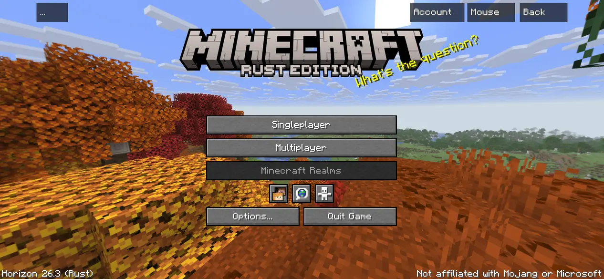
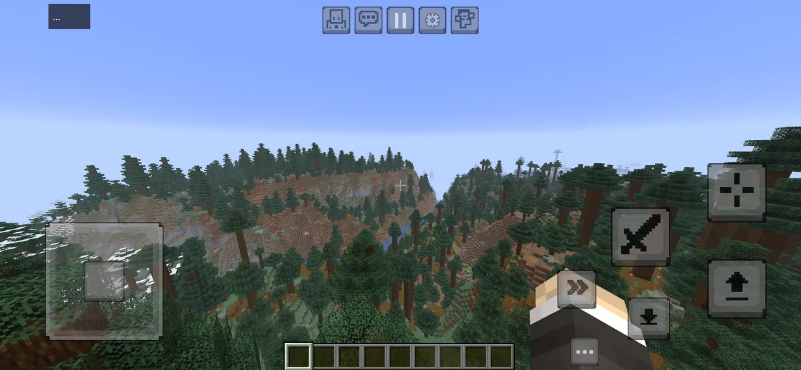
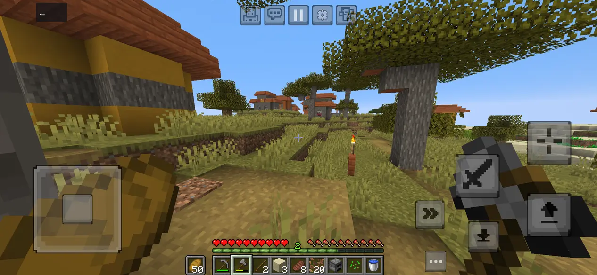
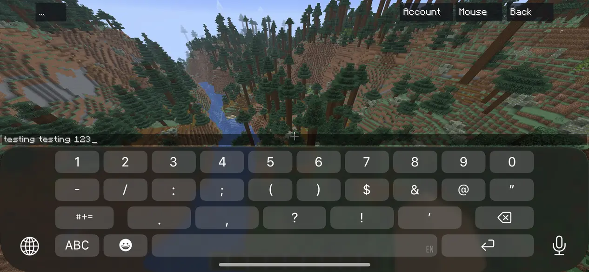
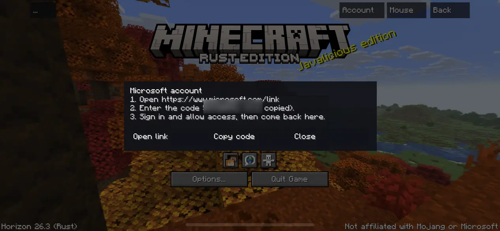

# Horizon iOS

An iPhone port of [Horizon](https://github.com/ludovic111/horizon), the Rust engine for
Minecraft: Java Edition 26.3. It is built on MocLG's Android port
([horizon-android](https://github.com/Vasysik/horizon-android)) and shares its touch controls.
Unofficial and in early development: on an iPhone 14 it plays single player with the touch
controls, signs in with a Microsoft account and joins Java servers, with rough edges left.

**iPhone · iOS 16+ · Metal · Touch controls and Bluetooth controllers · Sideloaded with SideStore or AltStore**

[Download a test build](https://github.com/Jotspot/horizon-ios/releases) ·
[iOS guide](docs/ios.md) ·
[Report an iOS bug](https://github.com/Jotspot/horizon-ios/issues/new) ·
[Android port](docs/android.md)

## iOS status

| Area | State |
| --- | --- |
| Unsigned `.ipa` built on GitHub Actions (macOS) | Working: every push to `ios` refreshes the `ios-latest` prerelease |
| Boot to the title screen, Metal rendering, full-screen landscape | Working on an iPhone 14 |
| Touch menus, the `...` key drawer, in-game touch buttons (joystick, jump...) | Working on an iPhone 14. The buttons' textures download on first launch |
| Bluetooth controllers through GameController (Xbox, PlayStation, MFi...) | Working on an iPhone 14 with a GameSir Nova Lite |
| Gyro aiming (Touch Controls → Gyroscope) | Written, waiting for a device test |
| Safe area, landscape, background and foreground | Working on an iPhone 14 |
| Single-player world, saves, options and logs in the Files app | Working on an iPhone 14 |
| iPhone keyboard in text fields and chat | Working on an iPhone 14; chat above the keyboard and clear of the notch fixed, waiting for a device test |
| Microsoft sign-in | Working on an iPhone 14 ([details](#multiplayer-on-ios)) |
| Joining Java servers | Working on an iPhone 14 for direct addresses; addresses with an SRV record (`hypixel.net`, `cubecraft.net`) fixed, waiting for a device test |
| Preparing resources on the phone | Not on iOS: it needs a JVM. Copy prepared resources in |
| Code mods (`.hmod` with code) | Not on iOS: they need a JIT, which iOS does not allow. Content mods load |
| iPad, portrait, system clipboard, narrator, rumble | Not yet |

The first target is an iPhone 14 (A15). Other iPhones with a recent iOS should behave the same,
but only that phone is being tested. See [the plan and the design notes](docs/ios.md) for how the
port works and what is left.

## On iPhone

iPhone 14 · iOS 27 · render distance 17

| **Title screen** | **Touch controls** |
| --- | --- |
|  |  |

| **Survival in a savanna village** | **Chat with the iPhone keyboard** |
| --- | --- |
|  |  |

| **Microsoft sign-in** |
| --- |
|  |

## Battery life

Horizon renders a full Java Edition world, so it uses far more power than most phone games. What
helps most, in order:

1. **Render distance** (Options → Video Settings): every chunk is generated, meshed and drawn.
   8 to 10 chunks costs much less than 17, and still looks good on a phone screen.
2. **Battery Mode** (Video Settings → Performance): at most 60 frames a second in a world and 30 in
   menus, and half the worker threads. On by default on iOS.
3. **Resolution Scale** (Video Settings → Display): the world at a percentage of the screen's
   2532×1170 pixels. 75% (the iOS default) draws about 44% fewer pixels; 60–70% is hard to tell
   apart on a 6-inch screen. The HUD and text stay sharp.
4. **Max Framerate** 30 if you don't mind it, and **Clouds** off.

iOS Low Power Mode also caps frame rates and works with Horizon. A phone that gets hot slows
itself down, so the settings above often make the game smoother too. New installs start with
Battery Mode on and resolution at 75%; an existing install keeps the settings it has, so change
them by hand once.

## Multiplayer on iOS

The iOS app runs the same engine as Horizon on desktop and Android. It speaks the Java Edition 26.3
network protocol itself, so it connects straight to Java servers: no Bedrock bridge, no proxy.

| | |
| --- | --- |
| **Servers without account checks** (`online-mode=false`) | Add the server by address and join under an offline name |
| **A world opened to LAN on another device** | **Multiplayer → Direct Connect** with that device's IP and port. Allow local-network access when iOS asks |
| **Hosting from the iPhone** | Open the world to LAN; others join by the iPhone's IP, while Horizon stays on screen |
| **Online-mode servers** | Sign in first: **Account** at the top of a menu screen. Realms is not supported by Horizon |
| **LAN worlds listed automatically** | Not with free signing: discovery uses multicast, which needs an Apple entitlement. Use Direct Connect |

iOS pauses apps that leave the screen, so switching apps for more than a few seconds drops the
connection, and a hosted world stops for its guests.

**Signing in.** Tap **Account** at the top right of a menu screen, then **Sign in**. Horizon copies
a short code and opens microsoft.com/link in Safari with it filled in; sign in with the account
that owns Minecraft: Java Edition, allow access, and come back. The account stays signed in between
launches: its refresh token is kept in the iPhone's Keychain, renewed when needed, and **Sign out**
removes it. This is the Microsoft device-code sign-in the Android app shares with the desktop
launcher (`launcher/src/account.rs`). As on Android, it uses a public Microsoft client ID that is
not registered for Horizon, a temporary development setup that Microsoft could stop; a build can
use its own registration through `HORIZON_MSA_CLIENT_ID`.

## Install on an iPhone

**1. Install Horizon.** Download `Horizon.ipa` from the newest `ios-build-N` release on the
[releases page](https://github.com/Jotspot/horizon-ios/releases) (each lists what changed). The
`.ipa` is unsigned: the tool you install it with signs it with your Apple ID. Either:

- **[Impactor](https://github.com/claration/impactor)** on a computer (macOS, Windows or Linux; the
  easiest start). Plug the iPhone in, sign in with your Apple ID in Impactor, and give it
  `Horizon.ipa`: it registers the phone, signs the app and installs it over USB. On macOS:
  `brew install --cask impactor`; on Linux it is on Flathub; on Windows it needs iTunes for the
  phone's drivers.
- **[SideStore](https://sidestore.io)** or **[AltStore](https://altstore.io)** on the iPhone itself
  (Impactor can install SideStore for you): open `Horizon.ipa` in it (**My Apps → +**).

The first time, allow the app under **Settings → General → VPN & Device Management**, and turn on
**Developer Mode** if iOS asks for it.

**2. Copy your game files.** On a computer, let the desktop Horizon launcher prepare the game from
your own copy of Minecraft: Java Edition (sign in and press **Play** once). It writes them to
`.local/horizon-client/26.3` inside the installed version's folder, where `<version>` is a folder
like `v2026.10.13.1` (take the newest):

| Computer | Folder to copy |
| --- | --- |
| macOS | `~/Library/Application Support/horizon-launcher/versions/<version>/.local/horizon-client/26.3` |
| Windows | `%APPDATA%\horizon-launcher\versions\<version>\.local\horizon-client\26.3` |
| Linux | `~/.local/share/horizon-launcher/versions/<version>/.local/horizon-client/26.3` |

The right folder has `horizon-resources.json` directly inside it. `Library` and `.local` are hidden:
on macOS use **Finder → Go → Go to Folder…** (Cmd+Shift+G) and paste the path, or press
Cmd+Shift+. to show hidden files. In Terminal, this zips the newest version's folder to your Desktop:

```bash
cd "$(ls -d ~/Library/Application\ Support/horizon-launcher/versions/*/.local/horizon-client | tail -n 1)" && zip -r ~/Desktop/26.3.zip 26.3
```

Copy that `26.3` folder to the iPhone under **Files → On My iPhone → Horizon → horizon-client →
26.3**: AirDrop the zip and unzip it in Files, or use Finder's file-sharing tab with the iPhone
plugged into a Mac. (If you set `HORIZON_LAUNCHER_HOME`, the launcher uses that folder instead.)

**3. Play.** Open Horizon with an internet connection the first time: it downloads the touch
buttons' textures (about 30 small files from Mojang's official samples), and works offline after
that. Saves, `options.txt`, logs and crash reports are in
**Files → On My iPhone → Horizon → horizon**; attach the newest log from `logs/` to a bug report.

With a free Apple ID the signature lasts 7 days and only a few sideloaded apps are allowed at once.
Re-sign before it runs out: install the new build again with Impactor, or refresh it in SideStore
or AltStore. Your saves are kept.

## Build the iOS app

There is no Xcode project. `.github/workflows/ios.yml` builds on a macOS runner:

```sh
rustup target add aarch64-apple-ios
IPHONEOS_DEPLOYMENT_TARGET=16.0 cargo build --release --target aarch64-apple-ios \
  -p horizon-client --bin horizon-client --no-default-features --features audio
tools/ios_package.sh target/aarch64-apple-ios/release/horizon-client .local/ios
```

`tools/ios_package.sh` packs the binary, [`packaging/ios/Info.plist`](packaging/ios/Info.plist) and
the icons into `Payload/Horizon.app`, then zips it into `Horizon.ipa`. On Linux,
`tools/ios_check.sh` runs `cargo check` for iOS without an SDK, which catches most compile errors
before CI. iOS code sits behind `#[cfg(target_os = "ios")]`, or
`#[cfg(any(target_os = "android", target_os = "ios"))]` where it shares Android's touch code, so
desktop and Android builds are unchanged. Never commit Minecraft's files: the app only reads
resources the player copies in.

## Licence and notices

Original copyright and third-party notices are retained in [LICENSE](LICENSE)
and [THIRD_PARTY_NOTICES.md](THIRD_PARTY_NOTICES.md). Mojang textures are not
licensed under Horizon's MIT license. Game files, prepared resources, accounts,
APKs and signing keys stay outside Git. This project is not affiliated with or
endorsed by Mojang or Microsoft.

<details>
<summary>Horizon Android (MocLG's port, which this fork builds on)</summary>

The Android app's own description, kept from its README.

**Android 9+ · Vulkan · Four touch schemes · Sandboxed `.hmod` mods**

[Download APK](https://github.com/Vasysik/horizon-android/releases) · [Build & play](docs/android.md) · [Contribute](CONTRIBUTING_ANDROID.md) ·
[Report an Android bug](https://github.com/Vasysik/horizon-android/issues/new?template=android-bug.yml)

## What works

- Four touch schemes: joystick or D-pad, each with tap or crosshair aiming.
- Editable button positions, sizes and opacity; handedness, circle size, optional
  360-degree movement, Auto Sprint and Sprint-button visibility.
- Java multiplayer, including the Hypixel Arcade lobby shown below.
- Native launcher, verified resource downloads, resource packs and `.hmod` import.
- Vulkan rendering modes and resolution scaling; Android keyboard, clipboard,
  AAudio sound and phone vibration through the existing game settings.
- Account status and Android Keystore storage; the current sign-in configuration
  is still for development. [Feature support and remaining work](docs/android-features.md).

The engine targets Minecraft Java **26.3**. Sandboxed `.hmod`
code mods run on 64-bit APKs. Source-only `.hnmod` mods require a separately
compiled client and are not supported on Android yet. Fabric/Forge Java code
does not run in this client. Server and anticheat
compatibility requires testing on the actual server.

## On Android

POCO M8 Pro · 16 chunks · Fancy graphics

| **Joystick and crosshair** | **D-pad and touch aiming** |
| --- | --- |
|  |  |

| **Snowy biome** | **Hypixel Arcade · Java multiplayer** |
| --- | --- |
|  |  |

| **Third-person view** | **Desert terrain** |
| --- | --- |
|  |  |

### Hypixel Arcade gameplay

https://youtu.be/gWK01tGlyFI

*Disasters gameplay recorded on Poco M8 Pro. FPS readings in the footage are not a controlled benchmark.*

### On a flip phone

Fujitsu F-03L · Portrait mode

| **Main menu** | **In-game** |
| --- | --- |
|  |  |

## Help build it

Try a developer build, send a reproducible bug report, or contribute a focused
pull request against `android`. Touch input, accessibility, hardware controllers,
Android lifecycle and real-phone profiling are useful areas to help.
[Start here](CONTRIBUTING_ANDROID.md). For the iOS port, testing on an iPhone and
reporting what you see (with the log from the Files app) helps most.

If the port is useful to you, **star the repository** so other players and
contributors can find it.

## Builds and source

[Build instructions](docs/android.md#build-developers-only) explain the SDK/NDK
setup and preparation for building the engine. The Android distribution APK
contains generated Horizon tables; it downloads original Minecraft resources and
sound from Mojang and the touch textures from Mojang's official sample repository.
No PC resource preparation is needed to install and play on the phone.
[Publication notes](docs/android-publication.md).

This branch preserves upstream authorship and history. [Upstream integration](docs/android-upstream.json)
records reviewed merges. Original deployment workflows remain disabled in this fork.

</details>

<details>
<summary>Upstream Horizon documentation (desktop)</summary>

The following is the upstream desktop project description. Its download links,
CI badges and parity claims describe upstream Horizon, not validation of this
Android fork.

<p align="center">
  
</p>

<p align="center">
  <a href="https://github.com/horizon-rust/horizon/actions/workflows/ci.yml"></a>
  
  
  
  <a href="#project-status"></a>
  
  <a href="LICENSE"></a>
</p>

<p align="center">
  <a href="https://playhorizon.dev"><b>Website</b></a> ·
  <a href="#download"><b>Download</b></a> ·
  <a href="https://playhorizon.dev/docs/"><b>Documentation</b></a> ·
  <a href="https://github.com/horizon-rust/horizon/releases"><b>Release notes</b></a> ·
  <a href="ROADMAP.md"><b>Roadmap</b></a> ·
  <a href="#project-status"><b>Project status</b></a> ·
  <a href="#contributing"><b>Contributing</b></a>
</p>

# Horizon

Minecraft: Java Edition 26.3, rewritten in Rust. Same worlds, same rules, same terrain, checked against the Java game by more than 300 differential harnesses. Free, open source and unofficial.

> Not an official Minecraft product, nor approved by or associated with Mojang or Microsoft. Horizon contains no Minecraft code, assets or data: you need your own copy of Java Edition 26.3.

## Download

Get **the Horizon launcher** from [playhorizon.dev](https://playhorizon.dev) or [the launcher releases](https://github.com/horizon-rust/horizon/releases?q=launcher-v&expanded=true) (Linux x86-64, macOS on Apple Silicon, macOS on Intel from the next Nightly, Windows x64). It installs and updates the game, prepares its files from your copy of Minecraft, and updates itself.

**You need** a Microsoft account that owns Java Edition ([why](docs/microsoft-account.md)) and a GPU with Vulkan or OpenGL 3.3 (Linux), Vulkan or DirectX 12 (Windows), or a Mac (Apple Silicon, or Intel from the next Nightly). An existing Minecraft install (official launcher, Prism, MultiMC...) is reused; without one, Play downloads 26.3 from Mojang for your account. Step by step: [Install and first launch](https://playhorizon.dev/docs/install).

<table>
  <tr>
    <td width="50%"></td>
    <td width="50%"></td>
  </tr>
</table>

## What works today

- **The game:** vanilla world generation, mobs, villagers, raids, redstone, every command, the HUD and the recipe book, on vanilla saves. Worlds from 1.8 to 26.2 are upgraded. [Status](#project-status).
- **Extras:** new menus, graphics presets, distant terrain up to 1024 chunks, controllers, zoom, minimap and more, off by default where they change the vanilla look. [Settings](https://playhorizon.dev/docs/settings).
- **Packs:** resource packs, and data packs with functions, predicates, item modifiers and world generation.
- **Multiplayer:** invite friends with a code, Open to LAN, join servers (online mode included). [Multiplayer](https://playhorizon.dev/docs/multiplayer).
- **Mods:** content mods (blocks, items, data) and native Rust mods, built by the launcher with nothing to install. Java mod jars do not run. [Mods](https://playhorizon.dev/docs/mods).

In the Rust client, with vanilla assets and no mods or shaders:

<table>
  <tr>
    <td colspan="2"></td>
  </tr>
  <tr>
    <td width="50%"></td>
    <td width="50%"></td>
  </tr>
  <tr>
    <td width="50%"></td>
    <td width="50%"></td>
  </tr>
</table>

## Host a server

The launcher's **Servers** page creates, starts, backs up and updates a server, and invites friends over Tailscale. On a VPS, `horizon-server` installs with one command and needs no Java. [Host a server](https://playhorizon.dev/docs/hosting) ([reference](docs/hosting.md)).

## Modpacks

The launcher imports Modrinth and CurseForge packs and plays the mods Horizon can carry over: today, content mods made of data and assets, not Java code. [Modpacks](https://playhorizon.dev/docs/modpacks).

## Agent control

AI agents and scripts can play Horizon. `horizon-ctl`, shipped with the game, reads its state as JSON and acts like a player; `horizon-ctl mcp` serves the same commands over MCP.

```sh
horizon-ctl launch --world Survival --seed 5 --wait   # finds the version the launcher installed
horizon-ctl state                                       # position, health, food, target, screen...
horizon-ctl find-block birch_log                        # the nearest logs
horizon-ctl goto -0.5 65 -2.5 --near 2.5                # walks there along a path
horizon-ctl break -1 65 -3                              # mines it; replies with the drops
horizon-ctl open-inventory && horizon-ctl click-slot 0  # menus: slots, buttons by label, text fields
```

Commands block until done and reply with the result; `horizon-ctl help` lists them all. [Agent control](docs/native-client.md#agent-control-horizon-ctl-and-mcp).

## Build from source

Needs Rust 1.90+, Python 3.10+, JDK 25, and on Linux `libasound2-dev libudev-dev`. `horizon-prepare` builds the game's resources from **your own copy** of Java Edition 26.3 (checked against `research-lock.json`) and never downloads it:

1. **Client:** play 26.3 once in the official launcher. Horizon reads `~/.minecraft` (or `--minecraft-dir` / `HORIZON_MINECRAFT_DIR`).
2. **Server jar:** the 26.3 server jar (`downloads.server.url` in `versions/26.3/26.3.json`), passed once with `--server-jar` or `HORIZON_SERVER_JAR`.

```sh
git clone https://github.com/horizon-rust/horizon.git
cd horizon
cargo run --release -p horizon-prepare -- --prepare --server-jar ~/Downloads/server.jar   # needs JDK 25
cargo run --release -p horizon-prepare -- sounds   # optional: sounds from your launcher install
cargo run --release -p horizon-client
```

Prepared files land in the gitignored `.local/`: never commit or share them. Options, controls and architecture: [the native client guide](docs/native-client.md); all developer docs: [docs/README.md](docs/README.md).

## Roadmap

What is in progress, what comes next and where to help: [ROADMAP.md](ROADMAP.md), or [playhorizon.dev/hub](https://playhorizon.dev/hub) with the work board and what shipped.

## Contributing

Issues and pull requests are welcome: read [CONTRIBUTING.md](CONTRIBUTING.md) (vanilla first, small pull requests). Questions: [Discord](https://discord.gg/playhorizon). Before a pull request, run the self-check and paste its output:

```sh
git config core.hooksPath .githooks
python3 tools/pr_ready.py
```

It runs rustfmt, clippy, the touched crates' tests, the Python tests, the public-tree check and the vanilla harnesses your change affects. Never commit game files, decompiled source or prepared resources.

## Project status

**Player-visible gaps: 833 open** of the 833 the [port ledger](tools/port_ledger.py) found, reading every vanilla 26.3 method against Horizon's code: vanilla behaviour a player would notice that Horizon doesn't have yet. By area: Screens, HUD and client packets [197](https://github.com/horizon-rust/horizon/issues/3518); Entity and block rendering, models [129](https://github.com/horizon-rust/horizon/issues/3519); Animals [110](https://github.com/horizon-rust/horizon/issues/3512); Server and players on the server [106](https://github.com/horizon-rust/horizon/issues/3520); Blocks, redstone and fluids [86](https://github.com/horizon-rust/horizon/issues/3516); Entities, projectiles, vehicles and decorations [64](https://github.com/horizon-rust/horizon/issues/3514); Monsters and bosses [53](https://github.com/horizon-rust/horizon/issues/3513); Mob AI, villagers and raids [35](https://github.com/horizon-rust/horizon/issues/3521); World, world generation and saves [32](https://github.com/horizon-rust/horizon/issues/3517); Items, enchantments and inventories [21](https://github.com/horizon-rust/horizon/issues/3515). This number goes down as gaps close (`tools/parity_gaps.py`); the harness results below say that what is tested matches.

The table is the project's own audit: every subsystem matches vanilla in every harness that compares it. 100% means 100% of what the harnesses compare, not that nothing else differs.

### Java parity: 100%

Scores: 0 (absent), 0.25 (started), 0.5 (playable, major features missing), 0.75 (mostly complete) or 1 (complete and verified by differential tests); the percentage is their average. Last audited 2026-10-13: all 281 harnesses pass on Linux and macOS. The [port ledger](tools/port_ledger.py) adds a method-by-method view of what is ported.

| Subsystem | Score | Main gaps |
| --- | ---: | --- |
| Window, input and game loop | 1 | None: game loop, options, camera, auto-jump, toggle sprint/sneak and frame limiter match |
| Assets and resources | 1 | None: item models match over 196,290 stacks; the resource pack screen over 3,000 sessions |
| Network protocol and multiplayer | 1 | None: joins vanilla servers; the dedicated server matches vanilla's files, login, configuration, play and command tree; LAN discovery over 462 cases (offline mode only) |
| Chunk storage and palettes | 1 | None: client and saves share paletted containers, identical to vanilla over 266 scenarios |
| Section meshing | 1 | None: 112 scenes and over a million quads identical to vanilla |
| Rendering | 1 | None: entity models, block entity renderers (407 cases) and animations (296), HUD overlays (2,200 states), the recipe book (600), player list, subtitles and world border match |
| Lighting | 1 | None: saved and relit light matches vanilla, slabs and stairs included |
| World generation | 1 | None: 2,352 whole chunks over 225 structure sites, in all three dimensions, identical to vanilla |
| Region files and saves | 1 | None: saves round-trip with vanilla; worlds from 1.8 to 26.2 upgrade as vanilla's DataFixers do |
| Entities and physics | 1 | None: attributes, spawn rules, natural spawning (15,500 cases), raids and patrols (1,900), `finalizeSpawn` (24,000) and mob AI (92 scenarios) match |
| Interaction and inventory | 1 | None: menu clicks over 8,000 sequences; recipe book placement (6,000), buttons (1,200), saved book (1,500), loom and crafter screens (1,600) |
| Menus, HUD and chat | 1 | None: every command (758 over 39,685 inputs), scoreboards (81,000 operations), the player list (872,000 draw calls), chat and its suggestions (3,000 sessions) match |
| Audio | 1 | None: the sound engine, sound events, music, situational music, ambience and subtitles match vanilla |
| Block behaviours and ticking | 1 | None: block updates, random ticks, redstone, dispensers (6,000 cases), crafters (4,000), container spills (4,000), copper golems and the sculk family (435 scenarios) match |

### Known issues

Skins served over https show the default skin unless already cached; pack icons show the unknown-pack texture in game; item tooltips lack attribute lines.

## Licence

[MIT](LICENSE), for the project's original work; dependencies keep their own licences ([notices](THIRD_PARTY_NOTICES.md)). Minecraft is a trademark of Mojang Synergies AB; its code and assets belong to Mojang and Microsoft under the [Minecraft EULA](https://www.minecraft.net/en-us/eula).

## Author

Made by [Ludovic Marie](https://lu4ovic.com) ([@ludovic111](https://github.com/ludovic111)).

</details>
